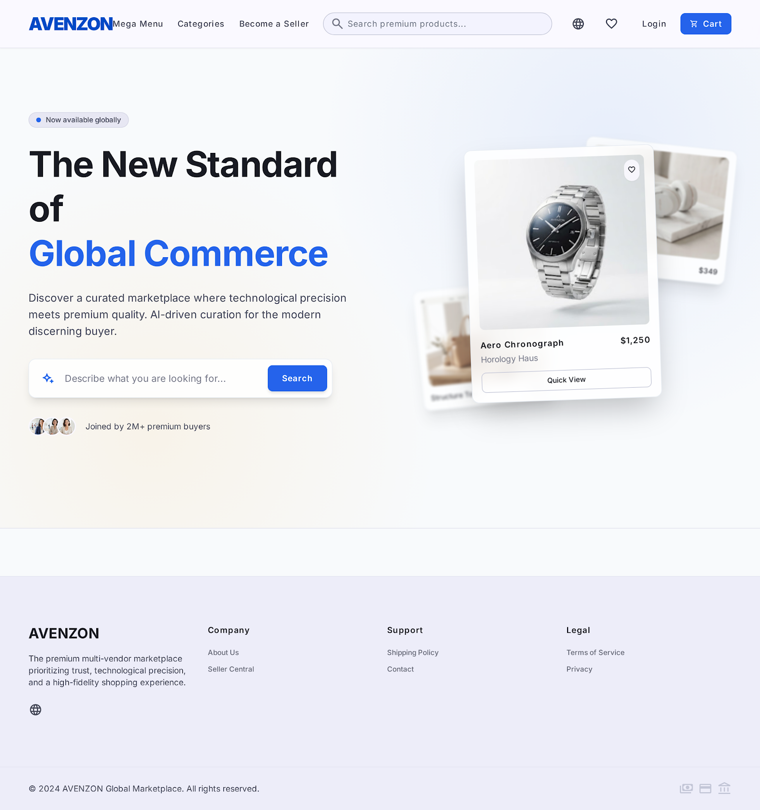

# AVENZON — Enterprise Multi-Vendor Marketplace

AVENZON is a multi-vendor marketplace application built with Next.js and React. The repository includes customer-facing shopping journeys, product discovery, account management, checkout screens, and dedicated vendor and administration areas.

<p align="center">
  
</p>

## Product areas

- **Marketplace discovery:** Home, catalog, categories, brands, search, and product comparison.
- **Product experience:** Product detail pages and product browsing routes.
- **Customer account:** Profile, addresses, orders, payments, notifications, and wishlist pages.
- **Checkout journey:** Cart, checkout, and order confirmation routes.
- **Vendor portal:** Dedicated seller portal layout.
- **Administration:** Dashboard, vendor management, user management, revenue, disputes, audit, and settings routes.
- **Public information:** About, blog, contact, FAQ, and terms pages.

These are application areas represented by routes in the repository; availability of production integrations and end-to-end workflows should be verified against the deployed environment.

## Technology

- Next.js 15 and React 18
- TypeScript
- Tailwind CSS
- Radix UI
- React Query
- React Hook Form and Zod
- Zustand
- Framer Motion

## Requirements

- Node.js 20 or later
- npm

## Run locally

```bash
git clone https://github.com/00tatheer00/AVENZON-Enterprise-Multi-Vendor-Marketplace.git
cd AVENZON-Enterprise-Multi-Vendor-Marketplace
npm install
```

Create a local `.env.local` file using the committed example:

```bash
cp .env.example .env.local
```

Review every variable and replace sample values with credentials for services that are actually configured. Never commit real secrets.

Start the development server:

```bash
npm run dev
```

Open [http://localhost:3000](http://localhost:3000).

## Available scripts

| Command | Purpose |
|---|---|
| `npm run dev` | Start Next.js development server |
| `npm run build` | Build the application |
| `npm run start` | Start the production server |
| `npm run type-check` | Run TypeScript checks |
| `npm run lint` | Run the configured lint command (verify compatibility with the installed Next.js version) |

## Repository structure

```text
src/
└── app/
    ├── (account)/       # Customer account and order pages
    ├── (admin)/         # Marketplace administration
    ├── (checkout)/      # Cart and checkout journey
    ├── (marketplace)/   # Catalog, search, categories, brands
    ├── (product)/       # Product detail routes
    ├── (public)/        # Public information pages
    └── (vendor-portal)/ # Seller portal
public/                  # Static assets and branding
stitch_avenzon_premium_marketplace_ui/ # UI reference screens
```

## Security

- Keep `.env.local` out of source control.
- Keep payment provider secret keys server-side only.
- Validate checkout, order, vendor, and admin operations on the server.
- Enforce role-based authorization for seller and admin routes.
- Do not treat hidden UI controls as authorization.
- Review third-party service configuration before production use.

## Project status

This repository represents an active marketplace application codebase. Before treating it as production-ready, verify authentication, payment processing, inventory consistency, order lifecycle, vendor isolation, authorization policies, and automated tests in the target deployment.

## License

No license file was identified during this documentation review. Confirm the intended license before redistributing or reusing this project.
